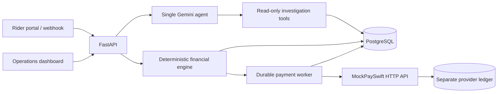

# QuickDrop

**A single-agent, AI-assisted rider payout dispute platform built with synthetic data and simulated payments.**

QuickDrop models the work an operations team does when a delivery rider reports a missing surge, incentive, partial payout, or incorrect deduction. A rider can explain the issue in English, Hindi, or Hinglish. One Gemini agent interprets the conversation and selects read-only investigation tools. Deterministic Python code checks the source records, calculates entitlement, enforces payment rules, and either reserves an eligible simulated correction or sends the case to an employee for review.

This is an original portfolio simulation. Every rider and transaction is synthetic. **No real money is transferred.**

## What it demonstrates

- A rider chat portal with persistent conversation and visible case and payment status.
- An employee dashboard with a pending queue, evidence, audit timeline, and reasoned approval or rejection.
- One Gemini agent with allowlisted, rider-scoped tools and a deterministic offline substitute for local testing.
- Versioned earnings rules using `Decimal`, provider-confirmed payout checks, and component-level allocation to prevent overlapping corrections.
- A ₹200.00 automatic correction ceiling, one automatic correction per rider per `Asia/Kolkata` business day, and human review for exceptions.
- MockPaySwift, a separate provider simulator with a durable ledger, idempotency keys, delayed or failed outcomes, and reconciliation.
- PostgreSQL operational storage, a durable worker, Docker Compose, tests, and an HTTP evaluation runner.

## Architecture



The model handles language, clarification, and tool selection. It cannot approve or execute a payment. The backend derives identity from authentication, validates tool arguments, checks source data, applies [policy `QD-2026-01`](docs/payout_policy.md), and records each decision. MockPaySwift is authoritative for simulated settlement; an HTTP acknowledgement or local status flag is insufficient. See [architecture](docs/architecture.md) and [security](docs/security.md) for the trust boundaries.

### Technology

Python 3.12 · FastAPI · Pydantic v2 · SQLAlchemy 2.x · Alembic · PostgreSQL · `google-genai` · HTTPX · Jinja2 · HTMX · Bootstrap · Pytest · Docker Compose.

## Run locally

Install Docker Desktop or a Docker Engine with Compose. Copy the environment template and set unique local secrets. Do not commit the resulting `.env` file.

```bash
cp .env.example .env
docker compose up --build --wait -d
docker compose run --rm seed
docker compose ps
```

In PowerShell, use `Copy-Item .env.example .env` for the first command when `.env` does not already exist. The `db_setup` service creates separate restricted runtime and seed roles, runs Alembic migrations with the database owner account, and grants data access before Uvicorn starts. Rerun `docker compose run --rm db_setup` to verify or repair migration and grant state. This setup also works with an existing Compose database volume; it does not replace or reset application data. The `seed` profile runs only when explicitly requested and can be rerun without replacing decisions. It creates synthetic source records, including rider `R0001` and employee `OPS001`. Their passwords come from `DEMO_RIDER_PASSWORD` and `DEMO_EMPLOYEE_PASSWORD` in your own `.env` file; no reusable passwords are published here. To show completed, pending-approval, and no-balance disputes in the browser, optionally run `docker compose exec -T app python -m scripts.seed_demo_disputes --base-url http://app:8000` after seeding.

| URL | Purpose |
| --- | --- |
| `http://localhost:8000/login` | Rider sign in |
| `http://localhost:8000/rider` | Rider conversation after sign in |
| `http://localhost:8000/ops/login` | Employee sign in |
| `http://localhost:8000/ops` | Operations dashboard after sign in |
| `http://localhost:8000/docs` | FastAPI API reference |

MockPaySwift is intended to stay private to the Compose network. Its API documentation is available from inside that network in development; it does not need a public host port for the rider workflow.

### Environment variables

The complete template is [.env.example](.env.example). Important settings are:

| Variable | Purpose |
| --- | --- |
| `POSTGRES_PASSWORD` | Database owner password used only by PostgreSQL and `db_setup` |
| `APP_DATABASE_PASSWORD` | Restricted runtime role password used by the API and worker; use URL-safe characters |
| `SEED_DATABASE_PASSWORD` | Separate source-data seed role password used only by the on-demand seed service; use URL-safe characters |
| `DATABASE_URL` | Connection string for commands run outside Compose; Compose sets a restricted role URL for the API and worker |
| `SESSION_SECRET` | Long random key for signed browser sessions; at least 32 characters |
| `WEBHOOK_TOKEN` | Bearer token for the simulated `/messages` integration |
| `MOCKPAYSWIFT_API_KEY` | Shared service API key for the simulator |
| `MOCKPAYSWIFT_URL` | Internal HTTP address of MockPaySwift |
| `DEMO_RIDER_PASSWORD` / `DEMO_EMPLOYEE_PASSWORD` | Local seed-account passwords |
| `AGENT_MODE` | `offline` for deterministic local behavior or `gemini` for live model calls |
| `GEMINI_API_KEY` / `GEMINI_MODEL` | Required key and selected Flash-class model when `AGENT_MODE=gemini` |
| `SECURE_COOKIES` | Enable for HTTPS deployments |

`AGENT_MODE=offline` needs no Gemini credential and is suitable for repeatable tests. `AGENT_MODE=gemini` uses the configured key for live language and tool calls. Synthetic live extraction, read-only tool requests, and reply composition have been verified; a full worker settlement retry received a Gemini HTTP 429 rate limit and safely deferred the case. The simulator never calls a real payment provider.

## Try the workflow

1. Sign in as the demo rider using the password from your `.env` file.
2. Ask about a seeded trip or payout discrepancy, then send a correction or follow-up message. The chat keeps both statements.
3. Watch the case and simulated payment status. A pending or uncertain transfer remains labeled as such until MockPaySwift confirms it.
4. Sign in as an authorized demo employee, open a pending case, inspect the evidence and audit timeline, and enter a reason for a decision.

For portfolio screenshots, capture the rider conversation with a case status card, then the operations queue and a case evidence page. Hide your browser's secrets and any `.env` contents. There are no pre-rendered screenshots in this repository, so images should represent an actual local run.

## API and evaluation

The simulated webhook accepts `POST /messages` with `Authorization: Bearer <WEBHOOK_TOKEN>` and returns JSON containing `reply`. It preserves rider, message ID, text, and received timestamp. `GET /trace/{rider_id}` and `GET /ops/pending` require authorization. [docs/api.md](docs/api.md) lists the browser and HTTP contracts.

For local development tests:

```bash
python -m pip install -e ".[dev]"
python -m pytest -q
ruff check .
ruff format --check .
```

With the stack running, the end-to-end evaluation entry point is:

```bash
docker compose exec app python -m evals.run --base-url http://app:8000 --provider-url http://mockpayswift:8001 --reset-fixtures
```

The evaluator reports deterministic financial outcomes separately from variable model wording. After a successful run, the seeded human approval can be exercised with `docker compose exec app python -m scripts.smoke_approval --base-url http://app:8000 --provider-url http://mockpayswift:8001`. The rider browser form can be checked with `docker compose exec app python -m scripts.smoke_rider --base-url http://app:8000`. These smoke commands mutate test data, so reset fixtures before rerunning the evaluation. Full live Gemini conversation quality needs its own evaluation beyond the offline report.

## Limits and future work

- This is a portfolio simulation, not a financial service or a messaging integration. No real payout or proactive WhatsApp notification is sent.
- Offline agent behavior is deterministic and useful for testing financial safety; it is not a measurement of live Gemini multilingual quality.
- Browser pages load pinned Bootstrap and HTMX assets from CDNs. Standard form submissions still work without HTMX; bundling the assets locally would improve fully offline presentation.
- The initial policy uses a simple cancelled-trip rule and three source surge categories. Later policies need explicit versioning and migration of new decisions, without changing historical ones.

See [assumptions](docs/assumptions.md) for the full simulation boundary. No license has been selected or repository published as part of this project.
