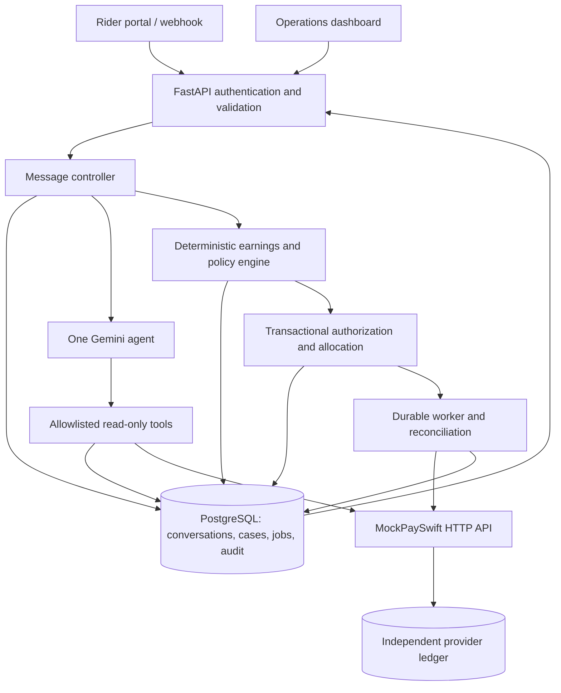

# Architecture

QuickDrop is a single-agent dispute resolution simulation. The assistant interprets messages and selects read-only investigation tools. Python services own identity, calculations, policy decisions, payment authorization, and reconciliation.

## Request flow

1. FastAPI authenticates a rider or webhook sender, validates a message ID and payload, and deduplicates retries.
2. The controller persists the message and loads the rider's conversation and structured dispute history.
3. One Gemini agent receives limited, trusted context. It can ask for clarification or use typed, allowlisted investigation tools. Tool access is scoped by the authenticated rider ID, never by a model-supplied identity.
4. Python creates or updates separate cases for separate claims and calculates each claimed component from source records and the versioned payout policy.
5. The authorization service locks and revalidates the available balance. Eligible small corrections can be reserved automatically; exceptions enter the operations queue.
6. A durable worker submits any reserved simulated correction to MockPaySwift using a stable idempotency key. Provider lookups and reconciliation establish settlement status.
7. Rider and employee views read the persisted case, payment, and audit state. Pending work is presented as pending, never as a confirmed payment.

The webhook has a short internal processing deadline. When investigation cannot safely finish in time, it persists work and returns a truthful processing acknowledgement. The worker can resume after process failure using durable jobs and the same provider idempotency key.

## Trust boundaries

- Rider text and retrieved records are untrusted input to the model. A prompt instruction cannot expand the tool allowlist or change financial rules.
- Gemini tool calls are validated and can read only rider-scoped investigation data. There is no model-visible payment, SQL, shell, or arbitrary URL tool.
- MockPaySwift has a separate ledger and API boundary. QuickDrop does not read its database directly.
- Local payment state is an operational cache. Provider-confirmed transactions are the settlement authority.
- Browser sessions, CSRF tokens, employee roles, and per-request authorization guard UI and API access.

See [payout policy](payout_policy.md) for the exact `QD-2026-01` calculation and reservation lifecycle, and [security](security.md) for threat controls.
